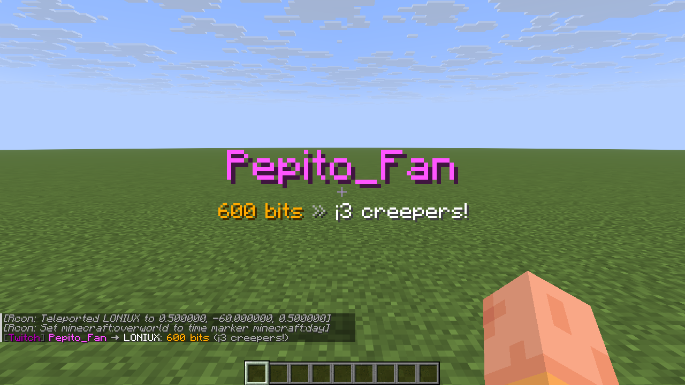

# BitsCraftPlugin

Plugin para servidores **Paper / Purpur 26.3** que conecta el canal de Twitch de cada streamer con su
partida. Si alguien dona 600 bits en el canal de LONIUX, aparecen 3 creepers junto a LONIUX. También
funciona con subs, subs regaladas, canjes de puntos del canal, raids y follows.

- Todo pasa en el servidor: **los streamers no instalan nada** en su PC (ni mods, ni OBS, ni overlays).
- Pueden jugar **varios streamers a la vez**. Lo de cada canal le pasa solo a su streamer.
- Es gratis: usa las herramientas oficiales de Twitch (EventSub).



---

## Para los streamers

### Conectar tu canal (una sola vez)

1. Entra al servidor y escribe **`/twitch vincular`**.
2. Te sale en el chat **«Haz clic aquí para conectar tu canal de Twitch»**. Haz clic, entra con tu cuenta
   de Twitch y acepta. Si te pide un código, es el que sale en el chat.
3. En unos segundos sale **«¡Listo! Tu canal quedó conectado»**.

Nunca escribes tu contraseña en el juego. El plugin solo pide permiso para **leer** bits, subs, canjes
y follows: no puede escribir en tu chat ni cambiar nada de tu canal.

### Comandos

| Comando | Qué hace |
|---|---|
| `/twitch vincular` | Conecta tu canal |
| `/twitch estado` | Muestra tu canal, si está conectado y cuántos eventos tienes en fila |
| `/twitch pausa` | Para todo: lo que llegue se guarda (hasta 50) |
| `/twitch reanudar` | Sigue con lo guardado, después de 10 s de respiro |
| `/twitch desvincular` | Desconecta tu canal y le quita el permiso a la app en Twitch |

Si te desconectas, lo que llegue mientras tanto también se guarda y sale al volver.

### Recompensas de puntos del canal

Créalas en el panel de tu canal de Twitch (**Panel de control → Recompensas → Puntos del canal**)
con **el mismo nombre** que tienen en el catálogo. Por ejemplo, una recompensa llamada `Saltito`.
No importan las mayúsculas ni los espacios de más. Las recompensas que no están en el catálogo
solo salen en el chat del juego.

---

## Para el admin del servidor

### 1. Registrar la app en Twitch (una vez, la hace una sola persona)

1. Entra a [dev.twitch.tv/console](https://dev.twitch.tv/console) con tu cuenta de Twitch y elige
   **Register Your Application**.
2. Rellena:
   - **Name:** el que quieras, por ejemplo `BitsCraftPlugin MiServidor`.
   - **OAuth Redirect URLs:** `http://localhost`. No se usa, pero el formulario la pide.
   - **Category:** `Game Integration`.
   - **Client Type:** **Public**. Es importante: así la app no tiene «secret» y no hay nada secreto
     que guardar en el servidor.
3. Guarda y entra a **Manage**. Copia el **Client ID**.

El Client ID no es secreto. Si en algún momento ves un «Client Secret», no lo copies ni lo compartas:
este plugin no lo usa.

### 2. Instalar

1. Copia `BitsCraftPlugin-x.y.z.jar` a la carpeta `plugins/` y reinicia el servidor.
2. Abre `plugins/BitsCraftPlugin/config.yml` y pega el Client ID:
   ```yaml
   twitch:
     client-id: "el_client_id_que_copiaste"
   ```
3. En la consola: `twitch recargar`.
4. Dale el permiso a cada streamer (con LuckPerms):
   ```
   lp user LONIUX permission set bitscraft.streamer true
   lp user LionGGZ permission set bitscraft.streamer true
   ```
   `bitscraft.admin` (por defecto, solo OP) agrega los comandos de prueba y control.

Requisitos: Paper o Purpur **26.3** con Java 25. WorldGuard y GriefPrevention son opcionales.

### Comandos del admin

| Comando | Qué hace |
|---|---|
| `/twitch probar <tipo> [monto o recompensa]` | Simula un evento sobre ti, sin Twitch. Tipos: `bits`, `sub`, `sub-regalo`, `puntos`, `raid`, `follow` |
| `/twitch probar-en <jugador> <tipo> [monto o recompensa]` | Lo mismo, sobre otro jugador (sirve desde la consola) |
| `/twitch estado <jugador>` | El estado de otro streamer |
| `/twitch pausa <jugador>` · `/twitch reanudar <jugador>` | Freno de emergencia para otro streamer |
| `/twitch vaciar <jugador>` | Borra la fila de un streamer |
| `/twitch recargar` | Vuelve a leer `config.yml` (catálogo, límites, textos) sin reiniciar |

Ejemplos: `/twitch probar bits 600`, `/twitch probar puntos Mob sorpresa`, `/twitch probar-en LONIUX raid 37`.

### Cambiar precios y acciones

Todo está en `config.yml`, sección `catalogo`. Después de editar, usa `/twitch recargar`; si algo
está mal escrito (un mob o un ítem que no existe), la consola lo dice.

Bits, subs y raids usan **escalones**: se elige el escalón más alto que no pase el monto. Con
escalones de 300 y 400, una donación de 350 bits cae en el de 300.

```yaml
catalogo:
  bits:
    600:
      nombre: "¡3 creepers!"          # lo que sale en el aviso
      acciones:
        - {tipo: mob, mob: creeper, cantidad: 3, nombre: "{usuario}"}
```

Tipos de acción:

| Tipo | Opciones | Ejemplo |
|---|---|---|
| `mob` | `mob`, `cantidad`, `nombre`, `cargado` (creeper), `armadura` (`cuero`, `hierro`, `diamante`...), `tamano` (slime), `enojada` (abeja), `distancia: [min, max]`, `por-cada`/`minimo`/`maximo` | `{tipo: mob, mob: zombie, cantidad: 10, armadura: hierro}` |
| `jefe` | como `mob`, para `wither` y `ender_dragon`; `rompe-bloques` | `{tipo: jefe, mob: wither}` |
| `mascota` | `mob`, `cantidad`: queda domesticado por el streamer y no desaparece | `{tipo: mascota, mob: wolf, cantidad: 5}` |
| `efecto` | `efecto`, `segundos`, `nivel` | `{tipo: efecto, efecto: levitation, segundos: 3}` |
| `dar` / `quitar` | `item`, `cantidad` (`quitar` solo saca lo de `quitar-permitidos`) | `{tipo: dar, item: golden_apple, cantidad: 1}` |
| `tnt` | `cantidad`, `mecha-ticks` (20 = 1 s), `distancia`, `rompe-bloques` (ver abajo) | `{tipo: tnt, mecha-ticks: 80}` |
| `nuke` | `lado` (10 = 10×10 TNT), `mecha-ticks`, `rompe-bloques` | `{tipo: nuke, lado: 10}` |
| `rayo` | `distancia`, `dano`, `fuego` | `{tipo: rayo, distancia: 3}` |
| `lanzar` | `altura`, `balde` (balde de agua en la mano) | `{tipo: lanzar, altura: 50, balde: true}` |
| `tp-azar` | `distancia` | `{tipo: tp-azar, distancia: 1000}` |
| `noche` | `segundos` (noche solo para el streamer) | `{tipo: noche, segundos: 60}` |
| `sonido` / `particulas` / `fuegos` | `sonido`, `particula`, `cantidad` | `{tipo: fuegos, cantidad: 3}` |
| `comando` | `comando`, lo corre la consola | `{tipo: comando, comando: "say {usuario} salvó a {streamer}"}` |
| `aleatorio` | `opciones`: lista de acciones, elige una | ver «Mob sorpresa» en el config |

**`rompe-bloques`** (en `tnt`, `nuke`, `mob` y `jefe`) decide dónde pueden romper bloques:

| Valor | Dónde rompe |
|---|---|
| `false` | En ningún lado (por defecto en la TNT y la nuke) |
| `true` | Solo fuera de las zonas protegidas (por defecto en los creepers) |
| `streamer` | Fuera de las zonas, y también en las zonas del streamer al que le donaron |
| `streamers` | Fuera de las zonas, y también en las zonas de cualquier streamer vinculado (lo que tienen el wither y el dragón) |

Una zona es «de alguien» si es el dueño del claim de GriefPrevention o de la región de WorldGuard.
Con `streamer` o `streamers`, el dueño además tiene que permitir explosiones en su zona, porque esos
plugins también las frenan: en GriefPrevention, `/claimexplosions` parado en el claim; en WorldGuard,
`/rg flag <región> tnt allow`, `creeper-explosion allow` y `other-explosion allow`.

En `nombre` y `comando` se puede usar `{usuario}`, `{streamer}`, `{canal}`, `{monto}` y
`{recompensa}`. Lo que viene de Twitch se limpia (solo letras, números y `_`) para que nadie pueda
meter texto en un comando. Los nombres de mobs, ítems y efectos son los de Minecraft en inglés
(`cave_spider`, `golden_apple`, `darkness`...).

Los títulos de las recompensas no pueden llevar punto (`.`) en el config.

### Límites

En la sección `ritmo` de `config.yml`:

| Opción | Por defecto | Qué hace |
|---|---|---|
| `retardo-aviso-segundos` | 3 | Tiempo entre el aviso en pantalla y la acción |
| `segundos-entre-acciones` | 2 | Mínimo entre una donación y la siguiente del mismo streamer |
| `acciones-por-minuto` | 20 | Máximo por streamer; lo demás espera su turno |
| `por-minuto` | tnt 3, rayo 5, nuke 1, jefe 2 | Topes de lo pesado |
| `mobs-vivos-por-streamer` | 30 | Si se llega, los mobs nuevos no aparecen |
| `mob-vida-segundos` / `jefe-vida-segundos` | 300 / 600 | Después desaparecen solos |
| `cola-maxima` / `cola-horas-maximas` | 50 / 24 | Lo guardado en pausa o desconectado |
| `gracia-al-volver-segundos` | 10 | Respiro al entrar o al reanudar |

Además:
- Los mobs de las donaciones **no sueltan ítems ni experiencia**, y los slimes no se dividen (no se
  pueden farmear).
- Las explosiones y los jefes **no rompen bloques en zonas protegidas ajenas** (regiones de
  WorldGuard, claims de GriefPrevention). Ver `rompe-bloques` arriba.
- `mundos-excluidos`: en esos mundos no pasa nada y lo que llega se guarda.
- El mensaje que la gente escribe con sus bits sale en el chat del juego como texto plano (máximo
  120 letras). Para ocultarlo: `avisos.mostrar-mensaje-bits: false`.
- Las mascotas de las subs (perros, loro, abeja, zorro, panda) se quedan para siempre.

### Ojo con GriefPrevention

- Si GriefPrevention trata un mundo como **creativo** (`GriefPrevention.Claims.Mode: Creative`, que
  pone solo si el servidor arranca en creativo), **borra los mobs fuera de los claims** y las
  donaciones no se van a ver. Debe estar en `Survival`.
- Por defecto GriefPrevention trae `BlockSurfaceCreeperExplosions: true` y
  `BlockSurfaceOtherExplosions: true`: los creepers y la TNT **no rompen bloques en la superficie en
  ningún lado**, aunque el catálogo diga `rompe-bloques: true`. Si quieren cráteres, pónganlo en `false`.

### Si algo falla

| Lo que pasa | Qué hacer |
|---|---|
| «Falta el client-id de Twitch» | Pega el Client ID en `config.yml` y usa `/twitch recargar` |
| Al streamer le sale «Tu canal de Twitch se desconectó del servidor» | Pasa si quitó la app en Twitch o si el servidor estuvo apagado más de 30 días. Que use `/twitch vincular` otra vez |
| No llegan bits o subs | Twitch solo tiene bits y subs en canales **afiliados o partner**. Revisa `/twitch estado`: debería decir «conectado (7/7 eventos)». Si no, la consola dice qué falló |
| No pasa nada con un canje de puntos | El título de la recompensa en Twitch tiene que ser igual al del catálogo |
| La consola avisa «Catálogo: mob desconocido» | Hay un nombre mal escrito en `config.yml` |

### Seguridad de los tokens

Los permisos de Twitch de cada streamer quedan en `plugins/BitsCraftPlugin/tokens/`, legibles solo
por el usuario que corre el servidor. **No compartas esa carpeta ni la subas a ningún lado.** Si se
filtra, basta con que el streamer quite la app en Twitch (**Configuración → Conexiones**) y vuelva a
vincular. El plugin nunca escribe tokens en la consola ni en los logs.

---

## Para desarrollar y probar

- `scripts/compilar.sh`: compila con Java 25 contra la API de Paper 26.3, corre las pruebas JUnit y
  deja el jar en `build/`. Con `--instalar` lo copia al servidor de prueba.
- `scripts/armar-servidor-prueba.sh --acepto-eula`: arma un servidor Paper 26.3 local en
  `servidor-prueba/` (127.0.0.1:25568, mundo plano, WorldGuard y GriefPrevention, con una región
  «protegida»). `--acepto-eula` equivale a aceptar el EULA de Minecraft.
- `scripts/arrancar-prueba.sh`: lo arranca. `python scripts/rcon.py "<comando>"` manda comandos.
- `python scripts/cliente-prueba.py LONIUX`: abre un Minecraft 26.3 de prueba conectado como LONIUX.
- `python scripts/probar-catalogo.py`: dispara todo el catálogo sobre LONIUX y revisa lo que aparece;
  `python scripts/probar-catalogo.py zonas` prueba las zonas protegidas.
- `python scripts/twitch-mock.py servir`: un EventSub falso en `ws://127.0.0.1:8080/ws`. Con
  `twitch.url-eventsub: ws://127.0.0.1:8080/ws` y `twitch.url-api: http://127.0.0.1:8080` en el
  config del servidor de prueba, `/twitch mock LONIUX 42 loniux` vincula un canal falso y
  `python scripts/twitch-mock.py disparar cheer 42 600` manda 600 bits.
- Con la [Twitch CLI](https://github.com/twitchdev/twitch-cli) en vez del mock:
  `twitch event websocket start-server` y luego
  `twitch event trigger channel.cheer --transport=websocket --to-user 42`.

Ver `PLAN.md` (decisiones) y `docs/PRUEBAS.md` (qué se probó).
